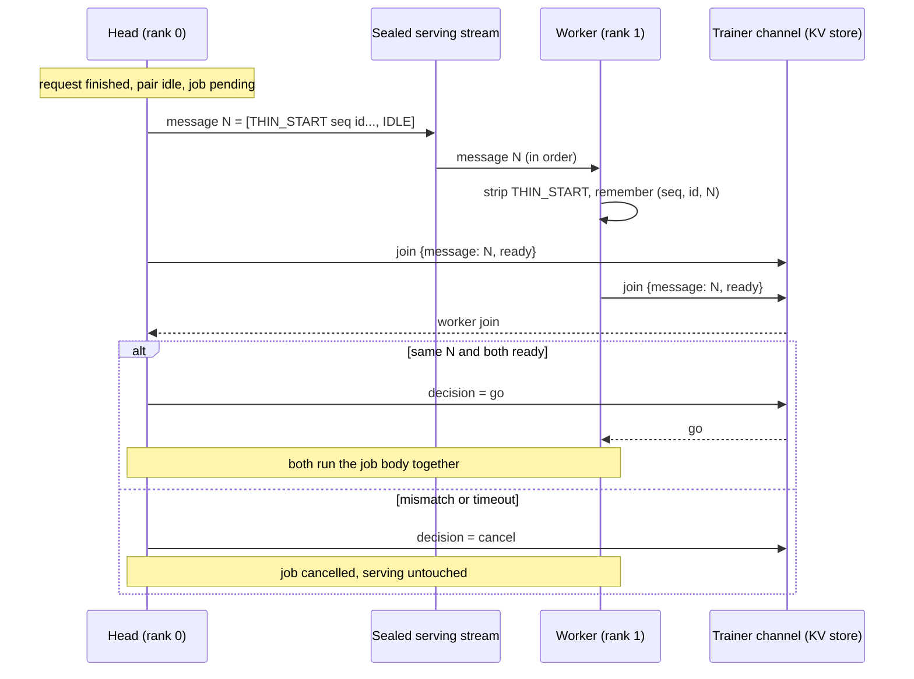
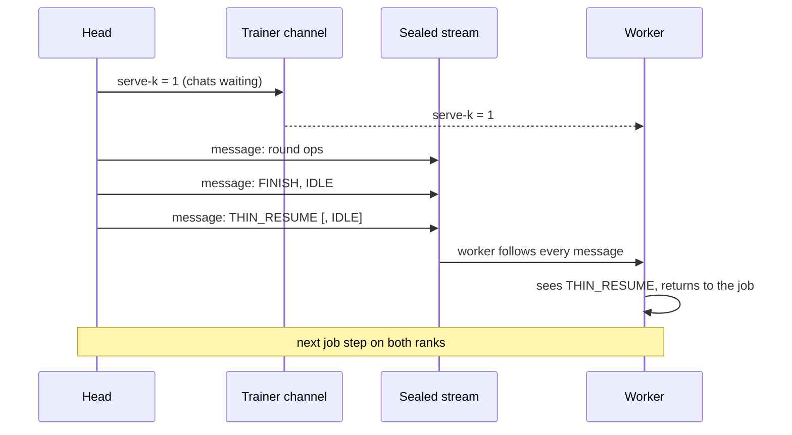
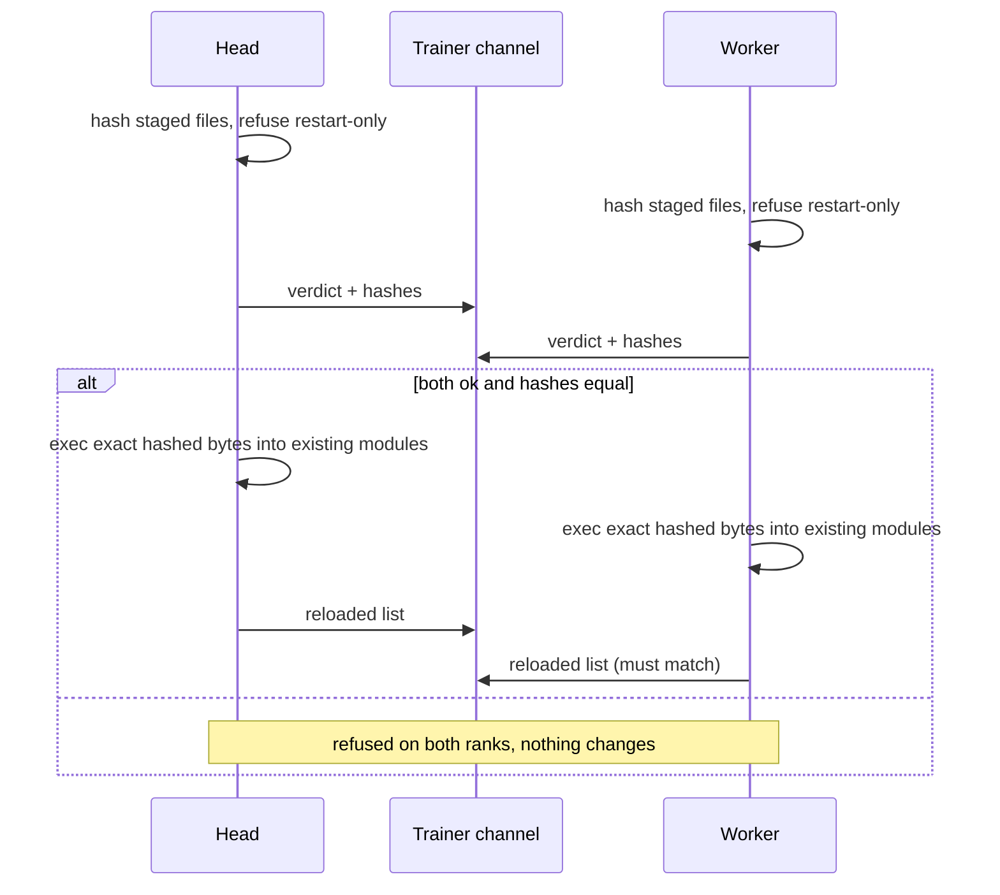

# Sequence diagrams

## 1. Paired sealed start



## 2. Nested serving during a job (resume marker)



Before the fix the worker returned after the first message and stalled the backward pass.

## 3. Doorbell skip after the job

```mermaid
sequenceDiagram
    participant H as Head
    participant W as Worker
    Note over H,W: job ends; last THIN_RESUME carried no IDLE (chats live)
    alt worker idle
        W->>W: wait for doorbell
    else chats live
        W->>W: skip doorbell, read next sealed message
    end
```

## 4. Hot-load


